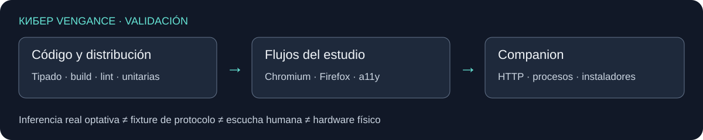

# Development, testing and publishing

## Run the studio

Node.js **22.12+** and npm. Production serves a static application and does not require Node.

```sh
npm ci
npm run dev
# http://127.0.0.1:4173
```

| Path | Responsibility |
| --- | --- |
| `src/core.ts`, `src/model.ts` | v6 model, migrations, musical events and history |
| `src/audio.ts`, `src/audio/`, `src/scratch-worklet.ts` | Scheduler, synthesis, DSP, routing, WAV and decks |
| `src/features/`, `src/ui/`, `src/app.ts` | Controllers, Preact shell, keyboards, dialogs and bridge |
| `src/ai/` | Composer and isolated optional engines |
| `companion/` | Loopback server, security, jobs, installation and native engines |
| `public/`, `index.html` | Static sources; `dist/` is generated and tracked |
| `docs/wiki/` | Versioned manual source; `docs/*.md` retains technical evidence |

[Architecture](../REFACTOR.md) · [Design](../DESIGN.md) · [Catalog format](../PRESET_CATALOG.md) · [I18N](../I18N.md).

## Checks



```sh
npx playwright install chromium firefox
npm run check:full
# Python 3.12+ for companion tests
python -m unittest discover -s companion/tests -v
node scripts/publish-wiki.mjs --check
```

`npm run check` runs typecheck, build, lint and unit tests; `check:full` adds all browser workflows and does not skip missing engines. Configure `CHROMIUM_EXECUTABLE_PATH` / `FIREFOX_EXECUTABLE_PATH` for custom binaries. `FIREFOX_PLAYWRIGHT_MODULE` selects a launcher matching an older Firefox. `PYTHON_EXECUTABLE` avoids requiring a `python` command.

Headless Linux: `node scripts/with-null-audio.mjs npm run check:full` uses PulseAudio/null output without certifying physical speakers. `PULSEAUDIO_EXECUTABLE_PATH` supports a custom installation.

Companion fixtures use a free port, temporary data and blocked Service Workers. They simulate protocol/PCM, not models. Workflows cover composition, history, persistence/binaries, audio/mixer/decks, exports, accessibility, responsive layout, cancellation and optional-engine loading boundaries.

## Optional inference and measurements

| Script | Requirements and output |
| --- | --- |
| `scripts/test-local-ai.mjs` | Real models; CPU/GPU/browser selection through `AI_TEST_BACKEND`, `AI_TEST_BROWSER`, `AI_TEST_PLAYWRIGHT_MODULE`, `AI_TEST_PORT` |
| `scripts/test-local-voice.mjs` | Real Kokoro; `VOICE_PRECISION=fp32` for comparison; samples in the system temporary directory |
| `scripts/test-expressive-voice.mjs` | Real Chatterbox; substantial download/memory |
| `scripts/verify-desktop-vocals.mjs` | Both installed engines; `KV_VOCALS_REAL_DATA` points to disposable acceptance data |
| `scripts/measure-ui.mjs` | Local load/DOM/asset measurements, not field metrics |
| `scripts/prepare-composer-listening.mjs` | Compiler comparison WAVs with a separate key; not model output or a completed preference study |

`VOICE_MODEL_MIRROR` supplies original model/runtime bytes, not generated outputs. `AI_TEST_UNSAFE_WEBGPU` variants are lab configuration, not guaranteed browser support. Listening, physical MIDI/microphone/headphones, Safari/Orion, memory and GPU measurements remain independent checks.

## Companion and releases

Development: `PYTHONPATH=companion python -m kv_companion`. Native packaging: `python companion/packaging/build.py --platform macos-x64`, `macos-arm64`, `windows-x64` or `linux-x64`, on the matching native runner. Python, uv and tools are hash-pinned; weights and drivers are excluded.

A master push affecting the companion builds artifacts. A `desktop-vocals-vX.Y.Z` tag matching the companion version builds four packages; the publisher verifies source/version/checksums, attaches them to a draft and publishes when complete. Differing existing assets are not replaced. Signing/notarization needs the owner's certificates.

## Manual and wiki

Edit `docs/wiki/`. Links ending in `.md` work in the repository; the publisher adapts page links and includes assets for GitHub Wiki. Use `--check` to validate or `--render /absolute/path` to prepare a copy without networking.

Publication requires **Settings → General → Features → Wikis** enabled and an initial Home page. GitHub requires a supported plan for private wikis. Run `node scripts/publish-wiki.mjs --publish`: it uses the SSH wiki remote, preserves unrelated pages and does not change visibility/settings. The repository copy remains usable when the native wiki is unavailable. [Official wiki documentation](https://docs.github.com/en/communities/documenting-your-project-with-wikis).

## Sites

GitHub and ChatGPT Sites have separate histories. Preserve `.openai/hosting.json`, audience and domain; synchronize verified files in an isolated checkout and publish through the Sites skill. Do not merge histories or deploy an unverified dist. GitHub pushes do not automatically deploy the Site.

[Project continuity](../../PROJECT_MEMORY.md) · [Product plan](../../PRODUCT_PLAN.md) · [Original specification](../../kiber-vengance.md).
