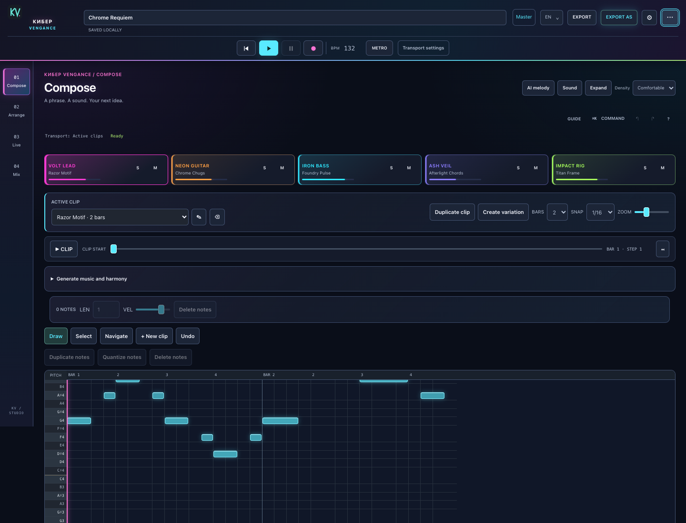

# КИБЕР VENGANCE manual

A browser studio for electro-rock, industrial, synthwave and cinematic composition. Four workspaces, five instruments, audio tracks and local export.

**[Open the studio](https://studio.suizman.org)** · [Get started](Getting-started.md) · [Shortcuts](Shortcuts-and-settings.md) · [Download companion](https://github.com/suizman/kiber-vengance/releases/latest)

## Find a feature

| I want to… | Guide and features |
| --- | --- |
| Play and make a first song | [Getting started](Getting-started.md): transport, tracks, clips and workspaces |
| Write and transform notes | [Composition](Composition.md): piano roll, selection, recording, harmony, Backing, quantization and variations |
| Design sounds | [Sound and presets](Sound-and-presets.md): synthesis, guitar, drums, ADSR, filters, arp/LFO, macros, FX, Vault, samples, slicing and catalogs |
| Arrange a song and edit audio | [Arrangement and audio](Arrangement-and-audio.md): sections, tempo/meter, markers, loop/punch, regions, microphone, Prism Keys, automation and MIDI Learn |
| Perform and capture a session | [Live performance](Live-performance.md): launcher, two Scratch Decks, crossfader, Cue and takes |
| Balance and finish a mix | [Mixing](Mixing.md): dB, Solo/Mute, groups, sends, sidechain, Master, LUFS, mono and A/B |
| Generate editable melodies | [Local AI](Local-AI.md): context, modes, A/B/C, Quality, partial regeneration and recipes |
| Generate vocals on desktop | [Speech and singing](Speech-and-singing.md): Kokoro, Chatterbox, DiffSinger, ACE-Step and companion |
| Save, recover or export | [Projects and export](Projects-and-export.md): v6, autosave, snapshots, JSON, Package, WAV, MIDI and stems |
| Customize the studio | [Shortcuts and settings](Shortcuts-and-settings.md): keyboard, MIDI, appearance, languages, guide and accessibility |
| Check compatibility and licenses | [Compatibility](Compatibility-and-licenses.md): browsers, offline operation, formats and practical limits |
| Develop, test or publish | [Development](Development.md): architecture, commands, tests, native packages, wiki and Sites |

## Reading the manual

**Compose, Arrange, Live and Mix** are the current workspaces. Forge, Audio and Perform are internal panel names, not extra workspaces. Guides and screenshots use the English interface; the app also supports Spanish.

This directory is the versioned manual source and works without a wiki. Publish the same pages to GitHub Wiki with `node scripts/publish-wiki.mjs --publish` after enabling and initializing the native wiki. [Maintenance and prerequisites](Development.md).
