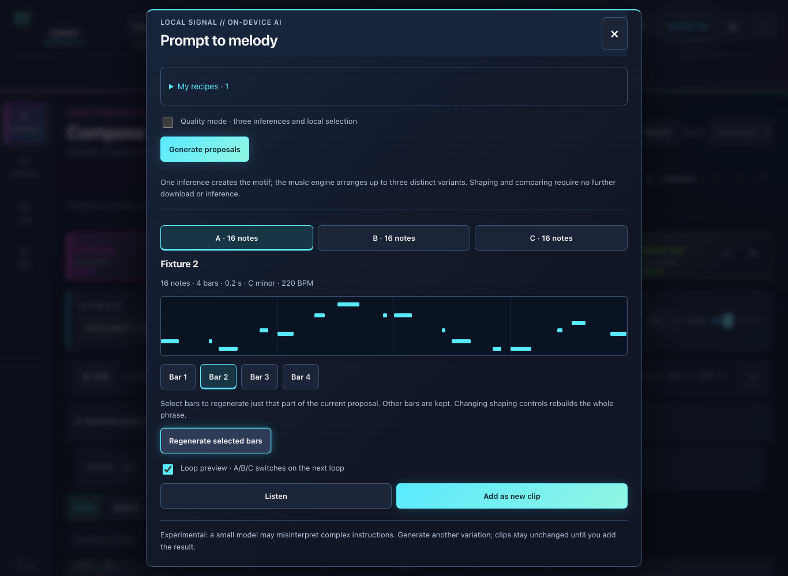

# Local AI: editable melodies

[English](Local-AI.md) | [Español](ES-Local-AI.md)

*Actual interface capture with a test fixture. Visible notes are not presented as model inference evidence.*

## Generate and compare

1. Select a melodic track and open **AI melody** from Compose, Project, Settings or the command palette.
2. Choose **New idea, Continue, Answer, Vary** or **Same motif, new rhythm**. Source modes require a clip containing notes.
3. Set key, scale, 1–8 bars, style, rhythm and preview BPM. **Fit the active clips** supplies harmonic context from active clips.
4. Explicitly load a model and generate. Quick mode uses one inference plan to compile up to three alternatives. **Quality mode** makes three sequential inferences and locally ranks/deduplicates them.
5. Compare A/B/C in a loop, shape proposals or regenerate selected bars. **Add as new clip** preserves the original and supports Undo/Redo.

## Musical control

Phrase/Loop/Free, automatic or 2/4/8/12 onsets per bar, register, maximum leap of 2/5/7/12 semitones and repetition/variation. The compiler enforces scales/bounds; restrictive settings can yield fewer distinct alternatives.

Context is limited to 512 notes per active melodic clip; it does not analyze audio or the entire arrangement. Shaping reuses the existing plan without inference. Partial regeneration retains notes outside selected bars; impossible boundary connections keep the previous proposal.

**Apply this BPM** is the only option that changes base tempo when inserting; later tempo-map events remain. Cancellation/failure retains the previous result.

## Recipes and engines

**My recipes** stores up to 100 browser-local recipes: name, prompt, style/rhythm, parameters and an optional compatible sound. Search, favorites, rename, delete and Undo delete are available. Source notes are excluded; the library has no synchronization or import/export.

**Automatic** probes page/worker GPU and falls back to CPU. GPU uses Qwen3 0.6B; CPU compatible uses SmolLM2 135M q8. Downloads are explicit and engines have separate caches. Cancel, Free memory and Delete downloads manage work/memory/models.

Small models can misunderstand complex instructions. Quality is heuristic selection, not a demonstrated listening preference. Output is editable notes, not recorded audio. [Compatibility/offline](Compatibility-and-licenses.md) · [Implementation](../LOCAL_AI.md).
