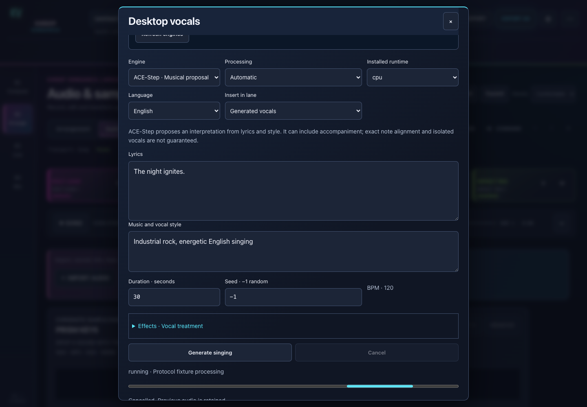

# Speech and singing on desktop

[English](Speech-and-singing.md) | [Español](ES-Speech-and-singing.md)

## Browser speech

In **Arrange → Audio & sampler → VOICE · ES/EN**, choose text, language, voice and speed; explicitly load a model, generate, audition/download WAV and insert a new region.

**Kokoro** offers English Heart/Michael and Spanish Dora/Alex, speed 0.6–1.5 and q8/FP32 precision. q8 downloads approximately 90 MB and FP32 330 MB, plus voices/runtime/phonemes. Each text line becomes a fragment with its own speed and following silence. This controls pacing, not unrestricted emotional instructions.

**Chatterbox** is an experimental desktop CPU engine: approximately 568 MB plus runtime, potentially minutes per generation, with restrained/natural/emphatic intensity. Computers reporting 4 GB RAM or less offer Kokoro instead. The experimental WebGPU backend is not offered as working generation; free-form Qwen instructions are not exposed.

Insertion captures the lane/cursor when generation starts. Each insertion creates a separate region with its WAV source and provenance, preserved through Undo/Redo, effects, reload and Package. Original/Processed auditions/downloads treatment without replacing the source.

Melody and speech share an inference lock. Cancel terminates the worker and retains the previous result; Free memory and Delete downloads manage model caches separately from projects.

## Companion singing

*Actual UI in an HTTP protocol test; fixture audio is not model output.*

Download the [published companion](https://github.com/suizman/kiber-vengance/releases/latest), open it, install a runtime/model and pair **Singing · Desktop** using its six-digit code. Browser local-network permission may be needed. Installers require private-repository access.

| Engine | Inputs and output |
| --- | --- |
| DiffSinger | Monophonic clip and syllables per note; `+` extends a vowel and `_` inserts silence; editable phonemes, vibrato, portamento and bank expressions. Up to 256 notes/120 seconds; overlaps rejected. Needs compatible ONNX bank/vocoder |
| ACE-Step 1.5 | Lyrics, style, ES/EN, BPM, 10–120 seconds and seed. Creates a musical proposal that may include accompaniment; exact melody and isolated vocals are not guaranteed |

Both offer progress, cancellation, Original/Processed preview, WAV, non-destructive insertion and completed-job recovery. One heavy job runs at a time. Models download separately and survive application updates.

## Installation and troubleshooting

macOS: separate Apple Silicon/Intel DMGs, macOS 13+; Windows x64: per-user installer; Linux x86_64: Arch/Ubuntu AppImage, with `--appimage-extract-and-run` when FUSE is absent. Python is bundled. Mac uses ad-hoc signing without notarization; Windows has no publisher certificate.

Intel uses ONNX Runtime 1.23.2 and cannot run ACE-Step's required PyTorch. Since 1.0.2, CoreML can run the acoustic model while vocoding uses CPU to avoid dynamic-length failures. **Installed CPU profile** and **CPU/Automatic generation device** are separate controls. Select CPU as a compatibility baseline; restart the old process after updates.

Kaiz includes a **CC-BY-NC 4.0** vocoder and is not cleared here for commercial releases. Review each bank/vocoder license or import compatible material with suitable permissions. Model weights are excluded from Project Package.

[Technical guide, hashes and evidence](../DESKTOP_VOCALS.md) · [Speech implementation](../LOCAL_VOICE.md) · [Compatibility](Compatibility-and-licenses.md).
