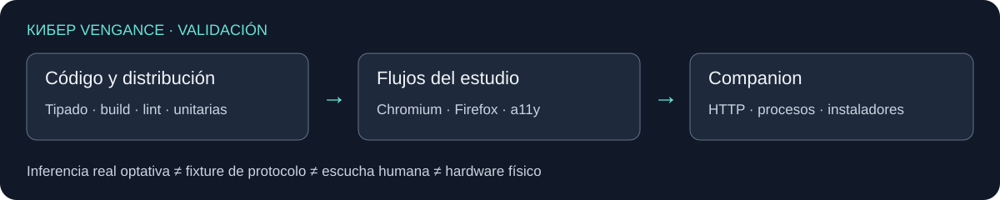

# Validating КИБЕР VENGANCE

Manual: [English (default)](https://github.com/suizman/kiber-vengance/wiki/Development) / [Español](https://github.com/suizman/kiber-vengance/wiki/ES-Development). Shared screenshots and diagrams use English labels in both editions.



## Run

Node.js **22.12+**; Python **3.12+** for companion tests.

```sh
npm ci
npx playwright install chromium firefox
npm run check:full
python -m unittest discover -s companion/tests -v
node scripts/publish-wiki.mjs --check
```

| Command | Checks |
| --- | --- |
| `npm run check` | Strict types, static distribution, lint and unit tests |
| `npm run test:e2e` | Chromium/Firefox workflows, audio, persistence, export, accessibility and responsive layouts |
| `python -m unittest discover -s companion/tests -v` | HTTP security, installation, jobs, cancellation and native contracts |
| `node scripts/publish-wiki.mjs --check` | Manual pages, links and images |

Missing browsers are not skipped. Set `CHROMIUM_EXECUTABLE_PATH`, `FIREFOX_EXECUTABLE_PATH`, `FIREFOX_PLAYWRIGHT_MODULE` or `PYTHON_EXECUTABLE` when defaults do not fit your environment.

On headless Linux: `node scripts/with-null-audio.mjs npm run check:full`. HTTP fixtures use a free port and temporary data; worker fixtures block Service Workers.

## Evidence

UI/protocol fixtures are not real inference. Model tests are opt-in because of downloads and memory use. Valid PCM and a null sink do not certify perceived quality, physical speakers, native Safari or GPU performance.

[Real-model scripts, environment variables, architecture and releases](../docs/wiki/Development.md) · [Compatibility limits](../docs/wiki/Compatibility-and-licenses.md).

`export-browser.test.js` verifies actual WAV/Vorbis encoding and decoding in Chromium/Firefox, dialog downloads, cancellation and waveform equivalence across offline checkpoints. Long local-project timings are recorded separately in project memory; they are not a cross-device performance guarantee.

## Studio 7 score and reliability checks

`tests/scores.test.js` covers MusicXML/MXL/GP, MIDI 0/1/2, ABC, ties/repeats, transposition, all parts and reversible insertion. `tests/scores-browser.test.js` uses real acoustic samples, notation, IndexedDB and PCM exports in Chromium/Firefox. `scripts/test-score-reader.mjs` runs genuine local optical inference separately from UI fixtures, including cancel/resume/cache reuse and checking there are no uploads. See `docs/SCORE_IMPORT.md` for exact models and prerequisites.

`node scripts/measure-large-project.mjs /absolute/baseline-checkout` compares identical 1,000/10,000-note projects under 4× CPU throttling. It writes `docs/performance-v7.json`; it is a lab comparison, not physical-phone latency. The baseline can be prepared with `git archive 31826ed dist scripts/serve.mjs` in a separate directory. Linux hosts without sound output need `node scripts/with-null-audio.mjs npm run check:full`.
